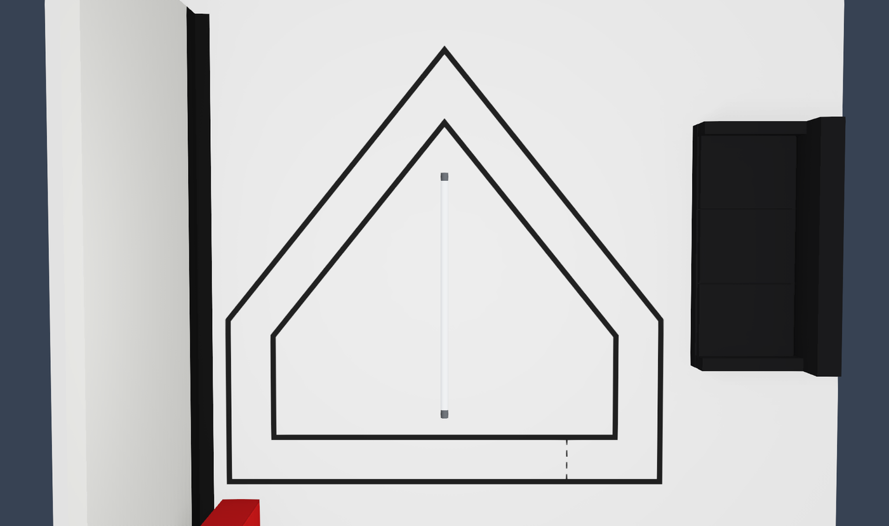

# 椰椰杯 Webots 赛道仿真环境

这是在 Webots R2025a 中验证的椰椰杯纯赛道仿真环境（仅包含场地、贴图、灯光与场边环境模型，不含任何小车模型或控制代码）。场地外轮廓按 `4 m × 4 m` 放样，白色通道宽 `360 mm`，两侧连续黑边各宽 `50 mm`。场景包含起终点虚线、紧贴墙脚的场外黑线、红色消防箱、右侧黑色银脚沙发，以及离地 `3.6 m` 的顶部灯管。



## 本次更新

- **校准起终点虚线位置与线宽**：起点虚线中心前移至 `x = 3.120 m`（第 5 弯内角后 `470 mm`、第 5 弯中心后 `650 mm`），线宽调整为 `10 mm` 细虚线（上下各 `45 mm` 贴边短线 + 中间两段 `60 mm` 悬空短线，间隙 `50 mm`）。
- **墙边地面黑线改为紧贴墙脚**：去掉左侧墙脚踢脚线与地面 `130 mm` 黑线之间的 `20 mm` 白缝，黑线直接紧贴墙面（`x = -0.248 ~ -0.118 m`）。
- **新增光滑喷绘布低摩擦压测地图**：新增 [`worlds/yeyebei_venue_slick.wbt`](worlds/yeyebei_venue_slick.wbt)，将 `"tire"` / `"track"` 摩擦系数下调至 `0.45`（`"caster"` / `"track"` 为 `0.25`），并为地面增加轻微镜面高光反射，用于验证低抓地力滑行与反光干扰场景。
- **补充工具与文档**：新增纯场地贴图生成脚本 [`tools/make_floor.py`](tools/make_floor.py)、俯视预览图 [`docs/venue_preview.png`](docs/venue_preview.png)、赛道关键坐标速查表及 `.gitignore`。

## 仓库目录与文件说明

| 路径 | 说明 |
| --- | --- |
| [`worlds/yeyebei_venue.wbt`](worlds/yeyebei_venue.wbt) | 默认常规抓地力赛道场景（`"tire"` / `"track"` 摩擦系数 `1.2`，`"caster"` / `"track"` `0.35`） |
| [`worlds/yeyebei_venue_slick.wbt`](worlds/yeyebei_venue_slick.wbt) | 光滑喷绘布低附着压测场景（`"tire"` / `"track"` 摩擦系数 `0.45`，`"caster"` / `"track"` `0.25`，带微高光） |
| [`worlds/textures/yeyebei.png`](worlds/textures/yeyebei.png) | `2048 × 2048` 赛道地面贴图，对应世界坐标 `x, y ∈ [-0.20, 4.20] m` |
| [`protos/VenueClutter.proto`](protos/VenueClutter.proto) | 场边静物模型：左侧白墙、紧贴墙脚的 `250 mm` 踢脚线与 `130 mm` 地面黑线、红色消防箱、黑色银脚沙发 |
| [`protos/CeilingTubeLight.proto`](protos/CeilingTubeLight.proto) | 离地 `3.6 m` 的顶部日光灯管及点光源阵列 |
| [`tools/make_floor.py`](tools/make_floor.py) | 独立纯 Python 标准库贴图生成脚本，可按需调整赛道参数并重新生成 `yeyebei.png` |
| [`docs/venue_preview.png`](docs/venue_preview.png) | 无车纯场地俯视预览图 |

> 提示：导入自定义小车模型时，建议在驱动轮和万向轮碰撞体的 `contactMaterial` 字段分别填入 `"tire"` 与 `"caster"`，即可自动套用标准图与光滑图中配置好的地面摩擦系数。

## 下载安装 Webots

1. 打开 [Webots R2025a 官方发布页](https://github.com/cyberbotics/webots/releases/tag/R2025a)。
2. Windows 64 位用户下载并运行 [Webots R2025a 安装包](https://github.com/cyberbotics/webots/releases/download/R2025a/webots-R2025a_setup.exe)。macOS 和 Linux 用户在同一发布页选择对应系统的安装包。
3. 安装完成后启动 Webots。

## 下载并打开地图

1. 在本仓库页面点击 **Code → Download ZIP**（或使用 `git clone`）下载并解压整个仓库。
2. 在 Webots 中选择 **File → Open World…**，按需打开：
   - 常规抓地力场地：[`worlds/yeyebei_venue.wbt`](worlds/yeyebei_venue.wbt)
   - 低摩擦光滑喷绘布压测场地：[`worlds/yeyebei_venue_slick.wbt`](worlds/yeyebei_venue_slick.wbt)
3. 请保持仓库原有目录结构不变，Webots 会自动从 `worlds/textures/` 读取赛道贴图，并从 `protos/` 加载场边物体与灯光模型。

## 赛道关键坐标速查表

坐标系单位为米（`m`），俯视逆时针外轮廓顶点为 `(0, 0) → (4, 0) → (4, 1.520) → (2, 4) → (0, 1.520)`，白色通道宽 `360 mm`，内外黑边各宽 `50 mm`，**中心线一圈总长 `11.597 m`**，底边直道中心线为 `y = 0.230 m`。推荐顺时针发车（车头朝 `-X`）：

| 关键点位 | 道路中心坐标 `(x, y)` / m | 内侧顶点 `(x, y)` / m | 顺时针转角 | 下一段中心线长度 |
| --- | --- | --- | --- | --- |
| `C1`（左下直角弯） | `(0.230, 0.230)` | `(0.410, 0.410)` | `90.0°` | `1.209 m` |
| `C2`（左侧肩弯） | `(0.230, 1.439)` | `(0.410, 1.375)` | `38.9°` | `2.820 m` |
| `C3`（顶部尖弯） | `(2.000, 3.634)` | `(2.000, 3.347)` | `102.2°` | `2.820 m` |
| `C4`（右侧肩弯） | `(3.770, 1.439)` | `(3.590, 1.375)` | `38.9°` | `1.209 m` |
| `C5`（右下直角弯） | `(3.770, 0.230)` | `(3.590, 0.410)` | `90.0°` | `3.540 m` |

- **起终点虚线**：中心位于 `x = 3.120 m`（线宽 `10 mm`，范围 `3.115 ~ 3.125 m`），横向跨越 `y = 0.050 ~ 0.410 m`；距离 `C5` 内角 `470 mm`、距离 `C5` 弯道中心 `650 mm`。
- **推荐起步位置**：`translation` 设为 `3.22 0.23 0`（`z` 按你的车模底盘高度微调），`rotation` 设为 `0 0 1 3.14159`（车头朝左 `-X`）。该位置贴近起点虚线右侧，适合测试“发车瞬间相机已越过起点虚线、一圈回来后再识别停车”的实车工况；如果希望静止发车时相机直接看到起点虚线，可将 `x` 向右移至如 `3.45 0.23 0`。
- **左侧场外黑线**：地面 `130 mm` 宽黑带覆盖 `x = -0.248 ~ -0.118 m`，紧贴左侧墙脚（`x = -0.248 m`），与赛道外侧黑边（`x = 0.000 m`）之间留有 `118 mm` 白色地面。

## 自定义生成赛道贴图

如果需要微调通道宽度、起点虚线位置或虚线分段尺寸，可直接修改 [`tools/make_floor.py`](tools/make_floor.py) 顶部的参数（如 `WIDTH`、`BOUNDARY_WIDTH`、`START_X`、`_DASH_SPANS`），然后在仓库根目录运行（仅依赖 Python 标准库，无需安装第三方包）：

```bash
python tools/make_floor.py
```

脚本会直接覆盖生成新的 `worlds/textures/yeyebei.png`，重新加载 Webots 场景（**File → Reload World**）即可生效。

## 下述内容可以让你的 agent 来做

## 添加小车并查看车载相机

下面用 Webots 自带的 `Khepera4` 作示例。这是一辆带前视相机的双轮差速小车。首次添加时，Webots 会从官方模型库下载资源。[Khepera4 官方模型](https://github.com/cyberbotics/webots/blob/R2025a/projects/robots/k-team/khepera4/protos/Khepera4.proto)

1. 打开赛道后暂停仿真。在左侧场景树选中最后一个顶层节点 `VenueClutter`，点击 **Add（+）**，选择 **PROTO nodes (Webots Projects) → robots → k-team → khepera4 → Khepera4**。
2. 展开 `Khepera4`。把 `translation` 设为 `3.22 0.23 0`，把 `rotation` 设为 `0 0 1 3.14159`。这样小车会放在底部起点虚线右侧，车头朝左。`translation` 的单位为米，`rotation` 最后一项的单位为弧度。
3. 使用模型默认的 `khepera4` 控制器，点运行。车载相机会自动开始采样，3D 窗口中会出现带紫色边框的原始相机画面。示例控制器会驱动小车移动，查看起点画面时可以短暂运行后暂停。
4. 如果预览被关闭，在场景树选中小车，再通过 **Robot → Camera Devices** 显示 `camera`。双击预览可以独立开窗。要保存加车后的地图，可以在原 `worlds/` 目录下另存一个 `.wbt` 文件。[Webots 相机预览说明](https://github.com/cyberbotics/webots/blob/R2025a/docs/reference/camera.md#overlay-image)

已有 Webots 车模时，可以把它的 `.proto` 和引用的网格、贴图一起放入本地 `protos/`，保留资源的相对路径，再从场景树导入。自己搭建简模时，将车体外观放进 `Robot`，再在其 `children` 里添加 `Camera`，设置相对位置、角度和分辨率。相机采样由该小车的控制器启用。[Webots Camera 参考](https://github.com/cyberbotics/webots/blob/R2025a/docs/reference/camera.md)

## 接入自己的小车控制程序

1. 在解压后的项目根目录下，将 `controllers/` 和 `worlds/` 放在同一级。已有 Webots 控制器时，把整个控制器子目录及它用到的资源复制进去。也可以在 Webots 选择 **File → New → New Robot Controller…**，创建名为 `my_car` 的控制器，再把自己的逻辑接到入口程序里。[Webots 控制器教程](https://github.com/cyberbotics/webots/blob/R2025a/docs/guide/tutorial-4-more-about-controllers.md)
2. Python 入口文件放在 `controllers/my_car/my_car.py`，目录名和入口名都用 `my_car`。C/C++ 则用向导生成的 Makefile，在 Webots 编辑器里选择 **Build → Build** 编译。Windows 下编译出的入口是 `controllers/my_car/my_car.exe`。Python 启动失败时，可以在 Webots 首选项的 **General → Python command** 选择本机的 Python。[Python 控制器配置](https://github.com/cyberbotics/webots/blob/R2025a/docs/guide/using-python.md)
3. 在场景树展开小车，把它的 `controller` 字段设为 `my_car`，保存场景后重置并运行。控制台出现 `Starting controller` 和你的入口文件名，就能确认已经绑定。相机、编码器和左右轮电机的设备名要与控制器中读取的名字一致。[Robot 的 controller 字段](https://github.com/cyberbotics/webots/blob/R2025a/docs/reference/robot.md)

复用单片机/视觉模块实车程序时，先把识别和控制逻辑接到能在电脑运行的 Webots 控制器。用 `Camera` 的画面替代实车采集，用 `PositionSensor` 给出轮编码器读数，再把控制逻辑算出的左右轮目标速度交给 `RotationalMotor`。视觉采集和单片机底层驱动等板端接口需要对应的电脑端适配。
